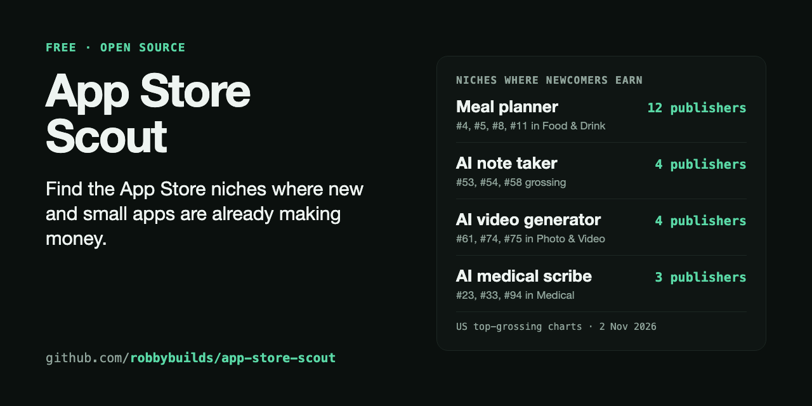

# App Store Scout

**Find app ideas that are already making money.**

Every day, App Store Scout reads Apple's top-grossing charts and points out niches where several *different* publishers' new or small apps are all earning. Then it searches the App Store for each niche to see how crowded it is, and reads those apps' 1, 2 and 3 star reviews to find what customers are unhappy about. It's free and open source, and it runs on GitHub Actions in your own fork.

**[See today's niches →](reports/us/latest.md)**



## What it found on day one

On 2 November 2026, the US Food & Drink top-grossing chart had **meal planners from 12 different publishers** on it. Four of them (mise, Whipp, NeatEat and Potto) launched this summer and were sitting at #4, #5, #8 and #11.

The same scan turned up AI note takers (4 publishers), AI video generators (4) and AI medical scribes (3). One app on a chart can be luck or a big ad budget. Several unrelated small teams earning with the same idea usually means real demand.

It also read 512 critical reviews of meal planner apps. **63% of them mention price, subscriptions or free trials.** A meal planner that's honest about its pricing has a head start.

## Get your own daily scan in 3 clicks

1. Click **Fork** at the top of this page.
2. In your fork, open the **Actions** tab and click **"I understand my workflows, go ahead and enable them"**.
3. Open **Actions → Daily scan → Run workflow**.

About six minutes later your fork has its first snapshot and a fresh report. After that it scans every day at 14:00 UTC and keeps a dated copy of the report every Monday. GitHub runs it for free on public repos.

To track other countries or categories, edit [`scout.config.json`](scout.config.json).

Optional: Google search volumes come from [seodata.dev](https://www.seodata.dev), which allows 20 free lookups a day without a key. Each niche is looked up once a month, so that's usually enough. For 50 a day, get a free key there and add it in your fork under **Settings → Secrets and variables → Actions** as `SEODATA_KEY`. To turn it off, set `"searchVolume": false` in the config.

## What's in the daily report

| Section | What it shows | Ready after |
|---|---|---|
| **Niches where newcomers are earning** | Phrases shared by new or small apps from 3+ publishers on grossing charts | Day 1 |
| **Inside each niche** | How crowded the App Store search is, the top results, monthly Google searches, and what 1 to 3 star reviews complain about | Day 1 |
| **Genres at a glance** | How many new and small apps made each category's grossing chart | Day 1 |
| **Small and paying** | Apps on a grossing chart with fewer than 5,000 ratings | Day 1 |
| **New and paying** | Apps released in the last year that are already on a grossing chart | Day 1 |
| **Climbing the grossing charts** | Places gained in a week | Day 8 |
| **Ratings momentum** | Fastest ratings growth in a week, relative to size | Day 8 |
| **Staying power** | New apps on a chart most days, rather than one-day spikes | Day 14 |

Then [the shortlist template](templates/shortlist.md) walks you from "interesting app" to "a narrower version I could build": who pays, what reviewers complain about, and whether you can reach those people.

## Run it on your computer

You need Node 22.18 or newer. There's nothing else to install.

```bash
git clone https://github.com/robbybuilds/app-store-scout
cd app-store-scout
npm run scan       # save today's charts and ratings, then search niches and read reviews
npm run report     # write reports/us/latest.md
npm run app -- 6777471316   # one app's chart history and its worst reviews
```

Add `-- --country gb` to scan or report another country.

## Let an AI agent do the legwork

[docs/agent-prompt.md](docs/agent-prompt.md) has copy-paste prompts for Claude Code, Codex or any agent that can run commands. The agent runs the scan, reads the report and the saved reviews for the most promising apps, and fills in the shortlist for you.

## Questions

**Is a top-grossing rank the same as revenue?**
No. It means an app out-earned the apps below it in that chart that day. Scout never turns ranks into dollar figures. [The guide](docs/guide.md) shows how to add free revenue estimates (AppTrendKit) and category benchmarks (RevenueCat) and label them honestly.

**Why not just use Sensor Tower or Appfigures?**
Use them too if you can. Scout adds a daily history that lives in your own repo as plain CSV files, so you can open it in a spreadsheet, change how it's scored, or hand it to an AI agent.

**Do I need to code?**
No. The fork-and-click setup above needs none, and the report is a page you read on GitHub.

**Does it cover Android?**
Not yet. Google Play has no free chart feed like Apple's.

**Where does the data come from?**
Four free Apple endpoints, none of which need a key: the chart feeds (ranks), the iTunes Lookup API (ratings, release dates, publishers), the iTunes Search API (what customers see when they search for a niche) and the customer reviews feed (the most recent 500 reviews per app). Monthly Google search volumes come from [seodata.dev](https://www.seodata.dev), a free third-party service. Each scan saves Apple's own "last updated" time, so a stale feed can't pass as fresh data.

## The data

```text
data/us/charts/2026-11-02.csv    chart, genre_id, rank, app_id
data/us/ratings/2026-11-02.csv   app_id, rating_count, average_rating
data/us/apps.csv                 name, publisher, genre, price, ratings, release date, link
data/us/scans.csv                when each scan ran and how fresh Apple's feed was
data/us/reviews/6777471316.csv   every review seen for that app, 1 to 3 stars first
data/us/search.csv               per niche per day: results, established apps, new apps
data/us/search/2026-11-02.csv    the top 10 search results for each niche that day
data/us/volume.csv               monthly Google searches per niche, refreshed every 30 days
```

The default config covers 3 charts × 11 categories × 100 apps in the US: about 3,300 chart positions and 2,800 apps a day, roughly 150 KB. Reviews are read for about 80 apps: around 3 MB the first day, then only new reviews. Reviewer names are never saved.

## Limits

- **Ratings lag downloads.** Most people never leave a rating.
- **Charts stop at 100**, so the long tail is invisible.
- **The category and grossing charts use Apple's older RSS feed.** It works today, and Apple could retire it. If that happens, the scan logs the failure and saves nothing for that chart.
- **Reviews are the latest 500 per app**, and unhappy customers write more of them. Read them for themes, not as a satisfaction score. The complaint themes are keyword matches, so open the reviews before you trust a percentage.
- **Google volumes are estimates** from seodata.dev, for "<niche> app". They measure web searches, not App Store searches. Check the related phrases too: "video generator app" gets 30 searches a month, while "ai video generator" gets 165,000.
- **Search stops at 200 results**, so "190 results" means "a lot", not an exact count.
- **Name-based niches are a starting point.** "Recipe" groups recipe managers with recipe magazines. Open the apps before you draw conclusions.

## Contributing

Ideas, issues and pull requests are welcome: new signals, better niche grouping, more countries in the default config. Run `npm test` before opening a PR.

If Scout helps you find an idea, a star helps other builders find it too.

## License

[MIT](LICENSE). Not affiliated with or endorsed by Apple.

---

Made by [Robby](https://github.com/robbybuilds), who teaches people to build and launch apps that make money in [Solo Software Studio](https://www.skool.com/solo-software-studio).
